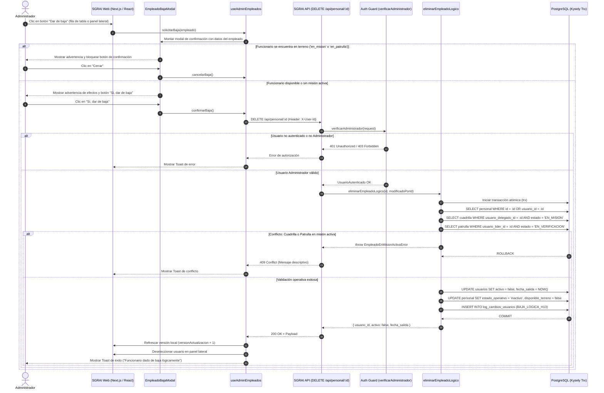
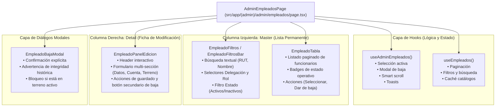

# Arquitectura y Diagrama de Secuencia UML — HU-13: Baja Lógica de Empleados

**Historia de Usuario:** HU-13 (Baja Lógica de Empleados / Desactivación de Personal)  
**Sistema:** SGRAI — Sistema de Gestión de Recursos para Atención de Incidentes  
**Institución:** Dirección de Gestión de Riesgo de Desastres (DGRD), Ilustre Municipalidad de Valdivia  

---

## 1. Diagrama de Secuencia UML

A continuación se detalla el ciclo completo de interacción entre el Administrador, la interfaz web Next.js, la capa de backend REST API y el motor de persistencia PostgreSQL (gestionado mediante transacciones atómicas con Kysely).

---

## 2. Diagrama de Estructura Modular de Componentes (Frontend)

Para garantizar desacoplamiento, mantenibilidad y adherencia a `docs/ARCHITECTURE.md`, la vista de Gestión de Personal (`src/app/(admin)/admin/empleados/page.tsx`) fue estructurada como una **vista delgada orquestadora** tipo Master-Detail, delegando estado y lógica en hooks especializados:

---

## 3. Decisiones de Diseño y Modelo de Datos

1. **Eliminación Lógica vs. Física:**  
   Se prohíbe terminantemente la ejecución de sentencias `DELETE FROM personal` o `DELETE FROM usuarios` debido a que destruiría la trazabilidad de partes de incidentes, reportes FIBE SENAPRED y bitácoras operativas ICS históricas.
2. **Desactivación Transaccional Simultánea:**  
   La operación en base de datos desactiva de forma atómica (`trx`):
   - `usuarios.activo = false` y `usuarios.fecha_salida = CURRENT_DATE`.
   - `personal.estado_operativo = 'inactivo'` y `personal.disponible_terreno = false`.
   - Registro de auditoría inmutable en `log_cambios_usuarios`.
3. **Protección de Operaciones Activas:**  
   Se impide la baja si el personal se encuentra actualmente en terreno o vinculado a una cuadrilla/patrulla en misión activa, evitando dejar despachos huérfanos sin responsable asignado.
