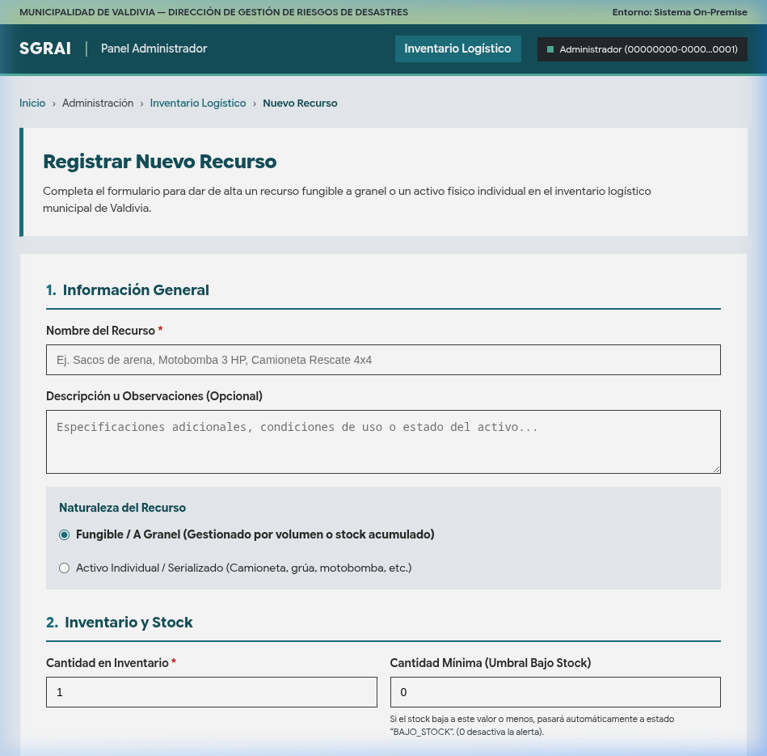
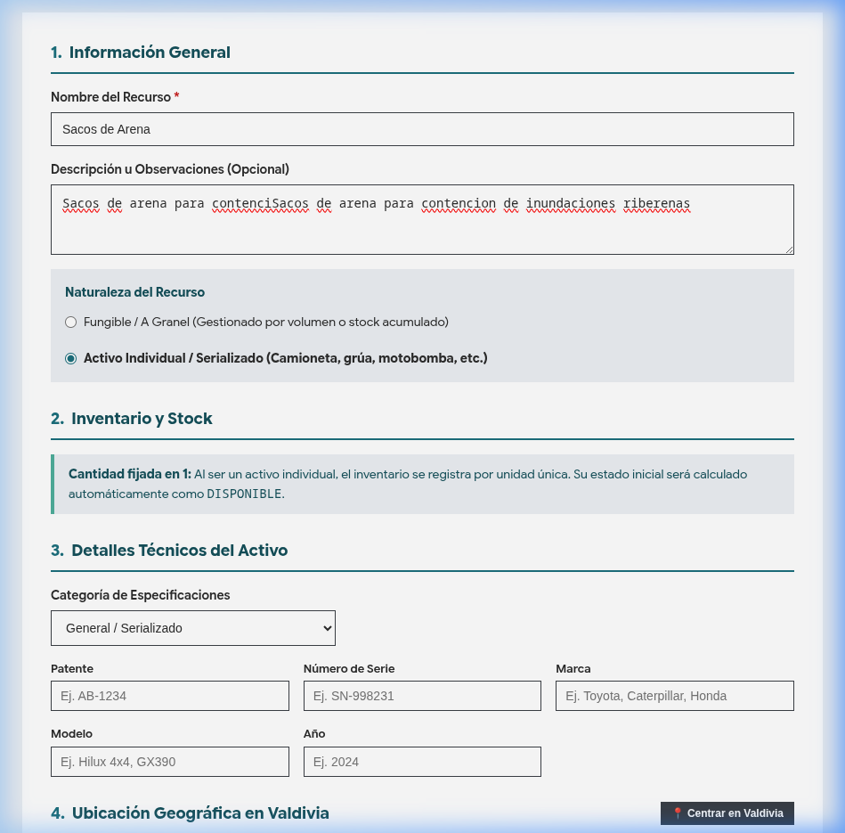
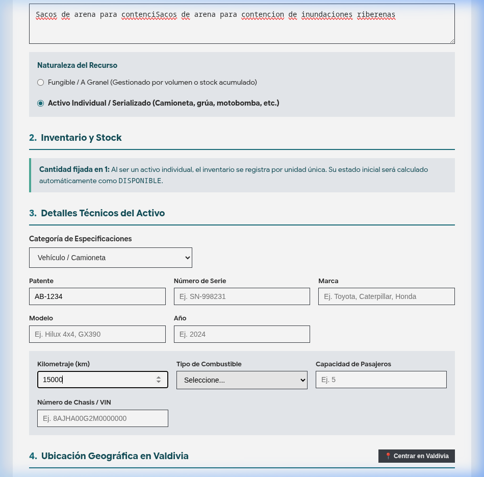
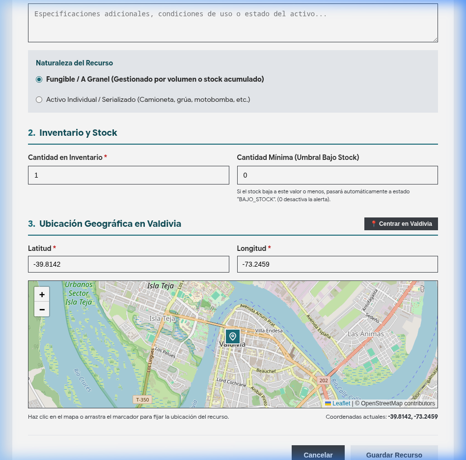

# Manual de Usuario — H6: Crear un Nuevo Recurso en el Inventario Logístico

## 1. Información General

- **Código de Historia de Usuario:** H6 (Backlog SGRAI)
- **Rol(es) Destinatario(s):** Administrador, Encargado de Logística Municipal.
- **Objetivo:** Permitir el ingreso, parametrización y registro oficial de nuevos recursos (fungibles a granel o activos individuales como maquinaria y vehículos) en el inventario logístico municipal para que queden disponibles para su asignación a cuadrillas o respuesta a emergencias.

---

## 2. Acceso a la Funcionalidad

1. Ingrese a la plataforma web institucional del SGRAI desde un navegador compatible.
2. Desde el Portal de Gestión (`/gestion`) o la barra lateral de navegación (`AppSidebar`), seleccione el módulo **"Inventario Logístico"** y haga clic en el botón destacado **"+ Registrar Nuevo Recurso"**.
3. La aplicación abrirá la vista de creación en la ruta canónica:
   ```
   /gestion/admin/recursos/nuevo
   ```
   *(Compatibilidad)*: La ruta `/admin/recursos/nuevo` se mantiene como alias redirigido.

---

## 3. Flujo Paso a Paso de Registro

### Paso 1: Información General
1. **Nombre del Recurso (Obligatorio):** Ingrese el nombre descriptivo del recurso (mínimo 3 caracteres, ej. *Sacos de Arena*, *Camioneta Rescate 4x4*, *Motobomba 3 HP*).
   > **Nota:** La validación en tiempo real alertará si el campo está vacío o no cumple con el largo mínimo antes de permitir guardar.
2. **Descripción u Observaciones (Opcional):** Ingrese detalles adicionales relevantes, condiciones de almacenamiento o notas operativas.
3. **Tipo de Recurso:** Seleccione entre:
   - **Material o Insumo:** Recursos fungibles gestionados por volumen o cantidad (ej. sacos de arena, frazadas, combustible).
   - **Vehículo o Maquinaria:** Unidades físicas únicas e identificables (ej. camioneta, grúa, motobomba).



### Paso 2: Control de Inventario y Umbral de Stock
- **Sin autocompletado por defecto:** El formulario se presenta en blanco para evitar el registro involuntario de valores por omisión.
- **Si seleccionó "Material o Insumo":**
  - **Cantidad:** Ingrese la cantidad entera inicial disponible ($\ge 0$). El casillero inicia vacío y es obligatorio. Los campos no admiten el ingreso de letras ni caracteres no numéricos.
  - **Cantidad Mínima:** Ingrese el umbral de alerta (*"Si el stock baja a este valor o menos, pasará automáticamente a estado de alerta (0 desactiva la alerta)"*).
- **Si seleccionó "Vehículo o Maquinaria":**
  - La cantidad se fija automáticamente en `1` unidad. El sistema calculará su estado inicial como `DISPONIBLE`.

### Paso 3: Especificaciones Técnicas (Solo para Activos Individuales)
Si marcó el recurso como individual, se habilitará la sección de detalles estructurados:
1. Elija la categoría correspondiente en el selector:
   - **General / Serializado:** Patente, Número de Serie, Marca, Modelo, Año.
   - **Vehículo / Camioneta:** Kilometraje, Tipo de Combustible (Diésel, Gasolina, Híbrido, Eléctrico, Otro), Capacidad de Pasajeros, Número de Chasis (VIN).
   - **Maquinaria / Grúa:** Capacidad de Carga (kg), Alcance Máximo (metros), Tipo de Grúa/Maquinaria, Horómetro (horas de uso).
   - **Motobomba / Bomba de Agua:** Caudal Máximo (L/min), Diámetro de Salida (pulgadas), Potencia del Motor (HP).
2. Complete los campos aplicables. Todos los campos técnicos son opcionales y solo se procesarán aquellos que contengan información válida.





### Paso 4: Ubicación Geográfica en Valdivia
El sistema requiere asociar las coordenadas geográficas de la base, bodega o depósito inicial del recurso. Inicialmente, no se preasigna ninguna coordenada (aparece como *"Sin seleccionar"*):
1. **Mini-mapa Interactivo:**
   - Puede hacer clic en cualquier sector del mapa comunal de Valdivia para colocar el pin en la posición exacta.
   - Una vez colocado el marcador, puede arrastrarlo para ajustar las coordenadas.
2. **Botón "Centrar en Valdivia":** Si desea ubicarlo en el centro de la ciudad (`-39.8142, -73.2459`), presione este botón utilitario.
3. **Entrada Manual:** También puede ingresar directamente los valores numéricos de latitud y longitud en los casilleros correspondientes.



### Paso 5: Revisión y Recuadro de Confirmación
1. **Prevención de envíos accidentales:** El formulario desactiva la tecla "Enter" dentro de los campos de texto e inputs numéricos para evitar que se envíe el formulario antes de completar la cantidad y la ubicación.
2. **Habilitación de guardado:** El botón **"Guardar Recurso"** solo se habilitará en color menta/teal una vez que los campos obligatorios (nombre, cantidad y ubicación geográfica) estén debidamente diligenciados.
3. **Recuadro de confirmación:** Al presionar **"Guardar Recurso"**, el sistema desplegará un **recuadro modal de confirmación** con un resumen estructurado de los datos:
   - Nombre y descripción del recurso.
   - Tipo de recurso y cantidad ingresada.
   - Umbral de alerta de stock.
   - Especificaciones técnicas cargadas (si es un activo individual).
   - Coordenadas geográficas en Valdivia.
4. En este recuadro dispondrá de dos acciones:
   - **"Modificar datos":** Cierra la confirmación y le permite continuar editando cualquier campo del formulario.
   - **"Confirmar y Guardar":** Realiza el envío definitivo a la API del sistema.

### Paso 6: Confirmación Final y Acciones Posteriores
Al crearse el recurso exitosamente, aparecerá un recuadro verde de confirmación con el mensaje:
> **"Recurso creado exitosamente"** — *El recurso "[Nombre]" ha sido registrado en el inventario logístico municipal.*

Se desplegarán dos botones alineados verticalmente:
- **Botón "Volver al listado (5s)":**
  - Posee una cuenta regresiva de 5 segundos con una barra de progreso inversa en su fondo.
  - Al completarse el tiempo, redirige automáticamente a `/recursos`.
  - **Pausa interactiva al hacer hover:** Si posiciona el cursor sobre el botón, la cuenta regresiva y la barra de progreso se congelan inmediatamente, permitiéndole permanecer en la pantalla.
- **Botón "+ Crear otro recurso":**
  - Restablece el formulario a su estado en blanco inicial para ingresar rápidamente un nuevo registro sin recargar la página.

---

## 4. Casos Especiales y Mensajes de Error

| Escenario | Comportamiento del Sistema | Acción Recomendada para el Usuario |
|---|---|---|
| **Campos obligatorios vacíos o incompletos** | El botón de guardar permanece deshabilitado y se resalta en rojo el mensaje específico (ej. "El nombre debe tener al menos 3 caracteres"). | Completar los campos requeridos con valores válidos. |
| **Error de validación del servidor (400 Bad Request)** | Se despliega una alerta roja superior detallando los errores devueltos por el backend. **Ningún dato digitado se pierde.** | Corregir los campos señalados en la alerta y volver a presionar "Guardar Recurso". |
| **Falla de conexión a la red o caída de servidor** | Se muestra una alerta indicando *"Error de red: no fue posible conectar con el servidor"*. El formulario retiene íntegramente todos los datos escritos. | Verificar el estado de la conexión a la red local/servidor y reintentar el guardado sin necesidad de reescribir. |
| **Falta de permisos o sesión no autorizada (401 / 403)** | Alerta de permisos insuficientes para la creación de recursos. | Contactar al administrador general del sistema para verificar que el usuario cuente con el permiso `recursos:crear`. |


---

## 5. Relación con Otros Sistemas y Repositorios

- **`sgrai-api` (Backend):**
  - Procesa la petición en `POST /api/recursos`.
  - Calcula automáticamente el `estado` (`DISPONIBLE`, `BAJO_STOCK`, `NO_DISPONIBLE`) según el balance de inventario y cantidad mínima.
  - Almacena la auditoría con la fecha, hora y el identificador del usuario que realizó la creación vía la cabecera `X-User-Id`.
- **Centro de Mando (`sgrai-web`):**
  - El Encargado de Centro de Mando podrá visualizar este recurso de inmediato para su asignación a cuadrillas, eventos ATP o incidentes.
- **`sgrai-pwa` (Móvil en Terreno):**
  - Cuando el recurso sea asignado a una misión, el Delegado de Cuadrilla podrá visualizarlo y reportar su uso en terreno desde la aplicación móvil.
