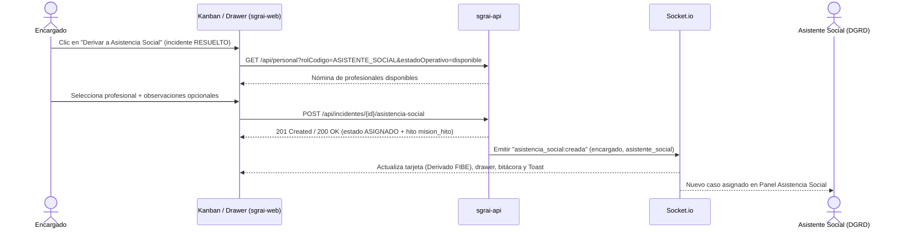
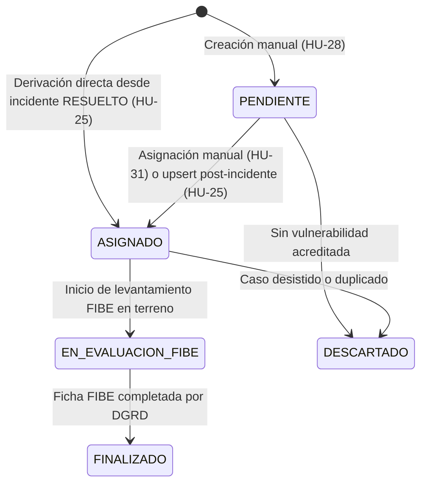

# Manual de Usuario — HU-25: Derivar Incidente Resuelto a Asistencia Social (FIBE / DGRD)

- **Historia de Usuario:** `HU-25` (Issue #59)
- **Rol destinatario:** Encargado de Centro de Mando (con permiso RBAC `asistencia_social:crear`)
- **Módulo:** Centro de Mando Operativo (`Tablero Kanban` y `Detalle de Incidente`)

---

## 1. Objetivo

Permitir al **Encargado** derivar inmediatamente un incidente en estado **Resuelto** hacia un profesional con rol **Asistente Social** disponible, cuando en el informe de terreno se constate afectación a personas (`personas_afectadas > 0`) o la marca de requerimiento FIBE (`requiere_asistencia_social = true`), iniciando sin demoras el levantamiento de la **Ficha Básica de Emergencia (FIBE)** por parte de la **DGRD**.

> **Nota institucional (Regla de negocio §3.5):** El sistema no contempla módulos de Albergues ni derivaciones a DIDECO. Toda situación de vulnerabilidad se gestiona exclusivamente mediante levantamiento de Ficha FIBE y entrega de beneficios a través de la Dirección de Gestión del Riesgo de Desastres (DGRD).

---

## 2. Flujo de trabajo y arquitectura

### Ciclo de vida del evento de asistencia social

---

## 3. Pasos para derivar un incidente resuelto

1. **Ubicar el incidente elegible en el Centro de Mando:**
   - En la columna **Resuelto** del tablero Kanban, los incidentes que registran personas damnificadas (`N damnificados`) o la etiqueta **FIBE** muestran el botón **Derivar a Asistencia Social** en el pie de la tarjeta.
   - También puedes abrir el detalle del incidente (`IncidenteDetalleDrawer`), donde aparecerá el banner superior **"Afectación social constatada — Pendiente derivación FIBE"** con el botón **Derivar a Asistencia Social**.
2. **Abrir el modal de derivación:**
   - Haz clic en **Derivar a Asistencia Social**.
   - Se abrirá la ventana modal mostrando el código del incidente, dirección, datos de contacto registrados (que se copiarán automáticamente al evento social) y el aviso institucional de uso exclusivo para Ficha FIBE / DGRD.
   - Si el incidente ya tenía un evento en estado `Pendiente`, el modal mostrará un aviso indicando que al confirmar se actualizará directamente a estado `Asignado`.
3. **Seleccionar al profesional disponible:**
   - El selector consulta en vivo a los profesionales con rol `ASISTENTE_SOCIAL` en estado `Disponible`.
   - Utiliza el buscador por nombre o RUT para filtrar la nómina y selecciona al asistente social mediante su botón de radio. Puedes usar **Actualizar** para refrescar la disponibilidad en cualquier momento.
4. **Agregar observaciones (opcional):**
   - Si requieres entregar indicaciones de acceso o priorización del grupo familiar, escríbelas en el campo de observaciones (máximo 500 caracteres).
5. **Confirmar la derivación:**
   - Haz clic en **Confirmar Derivación**.
   - El sistema mostrará una notificación **Toast** de éxito, actualizará la tarjeta del incidente con la etiqueta **Derivado FIBE** y el nombre del profesional asignado, y registrará el hito correspondiente en la bitácora de la misión (`MisionDetalleModal`).

---

## 4. Casos especiales y mensajes de error esperables

| Situación | Qué ocurre en pantalla | Qué hacer |
|---|---|---|
| **El incidente no está `RESUELTO` o no tiene damnificados ni marca FIBE** | El botón **Derivar a Asistencia Social** no se habilita (o la API responde `422 Unprocessable Entity`). | Verifica que la misión haya cerrado con el informe final de terreno y que se hayan registrado personas afectadas o necesidad de FIBE. |
| **El asistente social dejó de estar disponible antes de confirmar (`409 Conflict`)** | El modal muestra una alerta roja con el motivo y recarga automáticamente la lista de disponibles. | Selecciona otro profesional disponible de la nómina actualizada y vuelve a confirmar. |
| **Sin permiso RBAC (`403 Forbidden`)** | El botón no se muestra o el backend rechaza la solicitud indicando que falta `asistencia_social:crear`. | Solicita al Administrador verificar los permisos de tu perfil de Encargado. |
| **Incidente ya derivado (`ASIGNADO` o `EN_EVALUACION_FIBE`)** | La tarjeta y el drawer muestran la confirmación **Derivado FIBE** con el profesional asignado y un acceso directo al Panel de Asistencia Social. | Haz clic en **Ver en Panel Asistencia Social** para hacer seguimiento del levantamiento FIBE. |

---

## 5. Relación con otros repositorios y manuales

- **Backend (`sgrai-api`):** Endpoint `POST /api/incidentes/{id}/asistencia-social`, validación Zod, upsert en `evento_asistencia_social`, registro en `mision_hito` y emisión Socket.io `asistencia_social:creada`. Documentación técnica en [asistencia-social.md](file:///home/zetastormy/Development/SGRAI/web/docs/api/asistencia-social.md).
- **Terreno (`sgrai-pwa`):** El cierre de cuadrilla (`HU-68`) o patrulla verificadora (`HU-39`) que informa `personasAfectadas > 0` o `requiereAsistenciaSocial = true` habilita automáticamente este flujo al resolverse el incidente.
- **Manuales relacionados:**
  - [H15 — Tablero Kanban del Encargado](file:///home/zetastormy/Development/SGRAI/web/docs/manuals/H15-tablero-kanban-encargado.md)
  - [H28 — Crear Evento de Asistencia Social](file:///home/zetastormy/Development/SGRAI/web/docs/manuals/H28-crear-evento-asistencia-social.md)
  - [H31 — Asignar Asistente Social](file:///home/zetastormy/Development/SGRAI/web/docs/manuals/H31-asignar-asistente-social.md)
  - [H68 — Cierre de Misión de Cuadrilla en Mando](file:///home/zetastormy/Development/SGRAI/web/docs/manuals/H68-cierre-mision-cuadrilla-mando.md)
